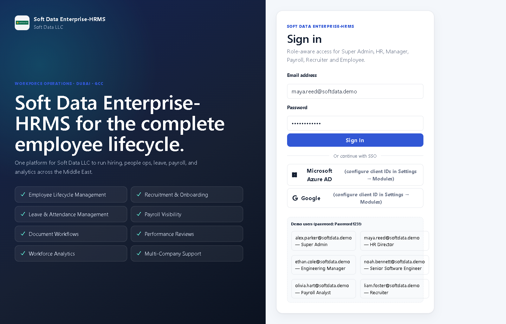
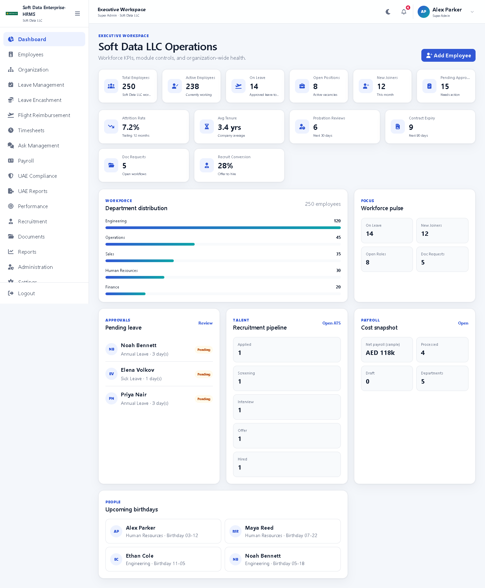
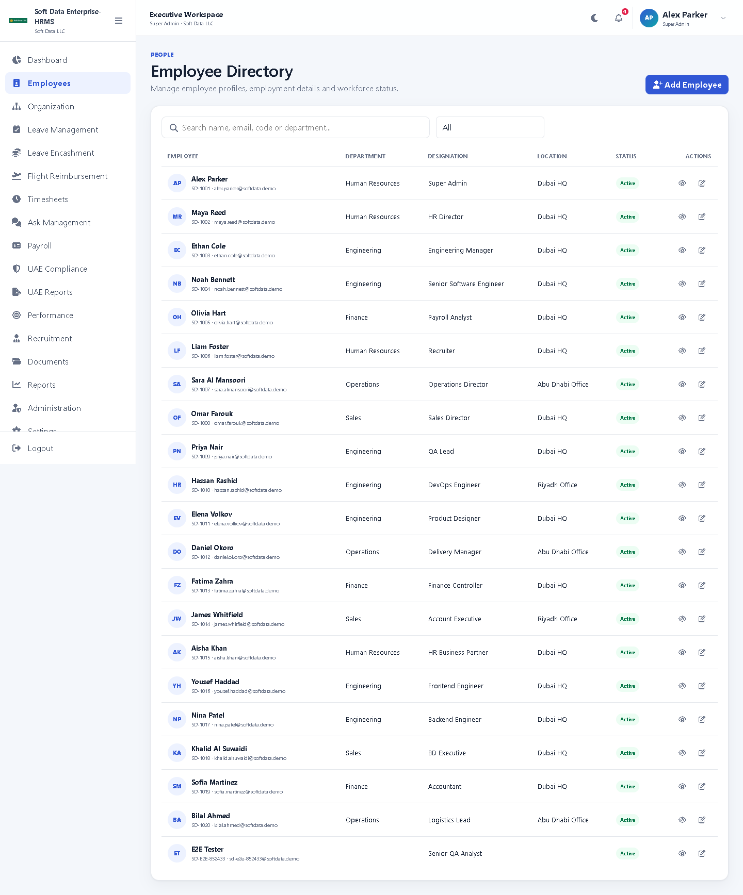
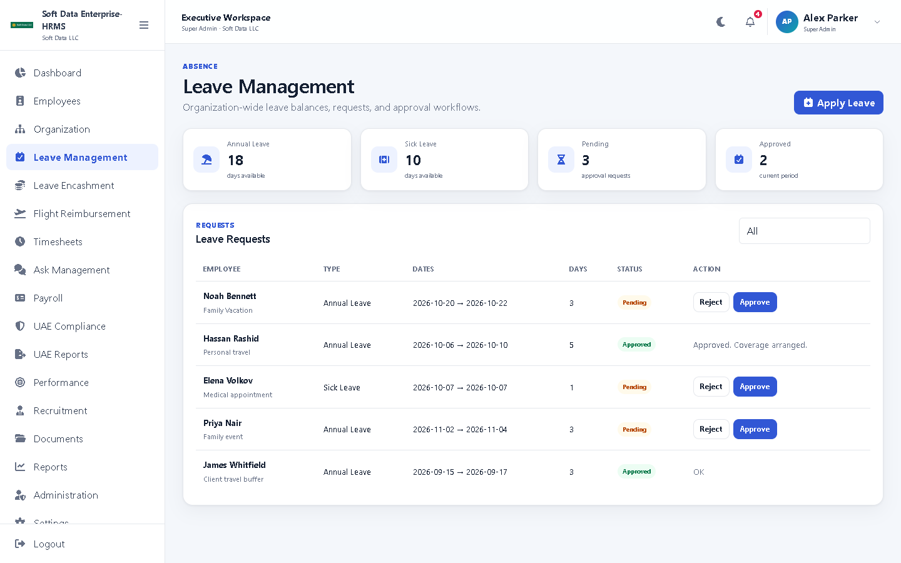
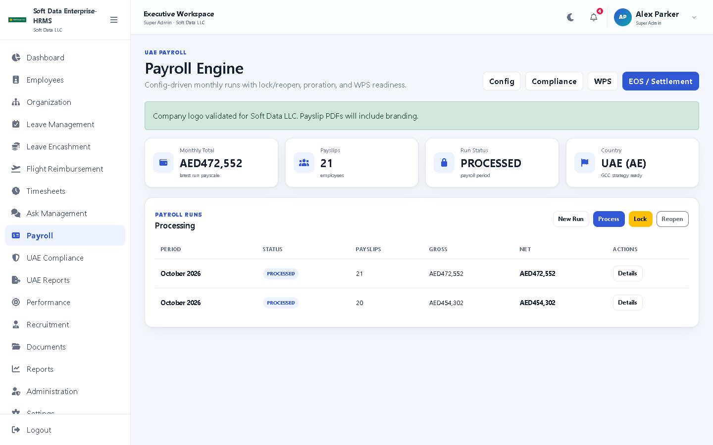
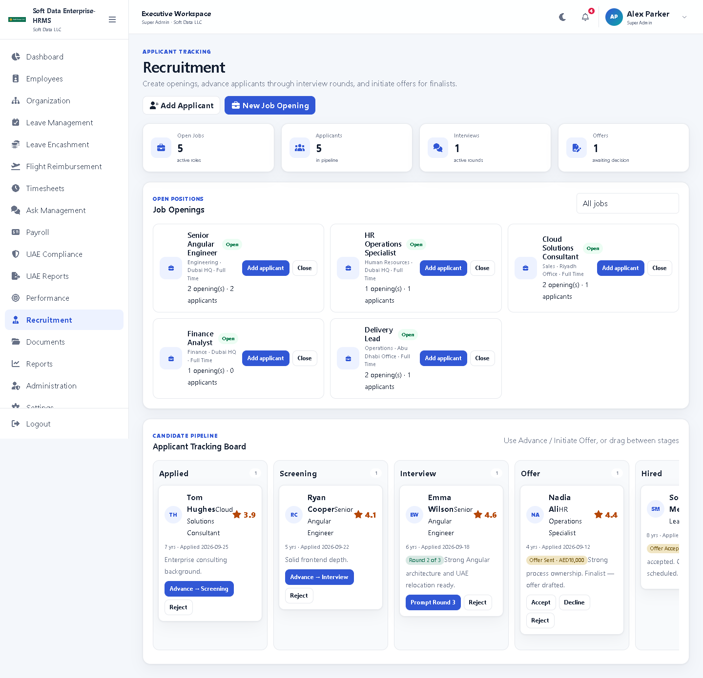
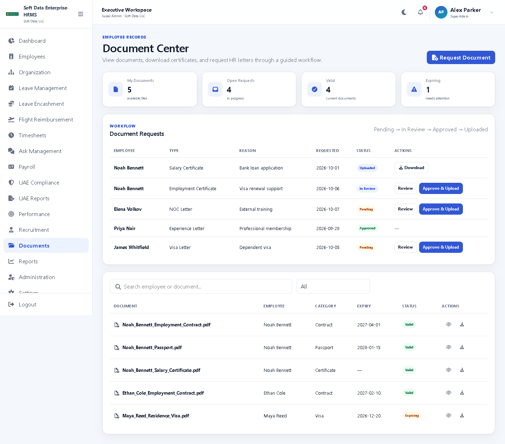
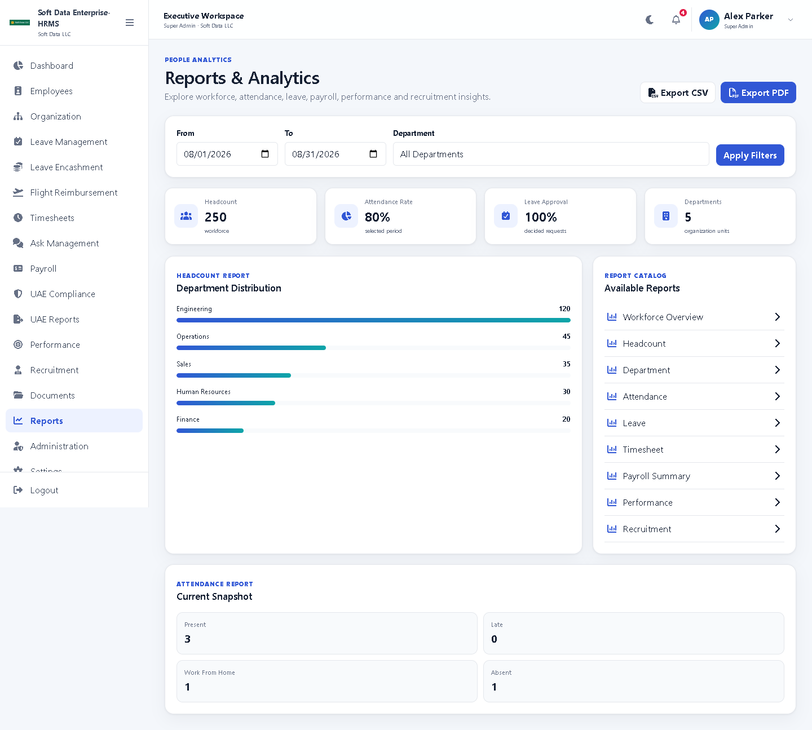
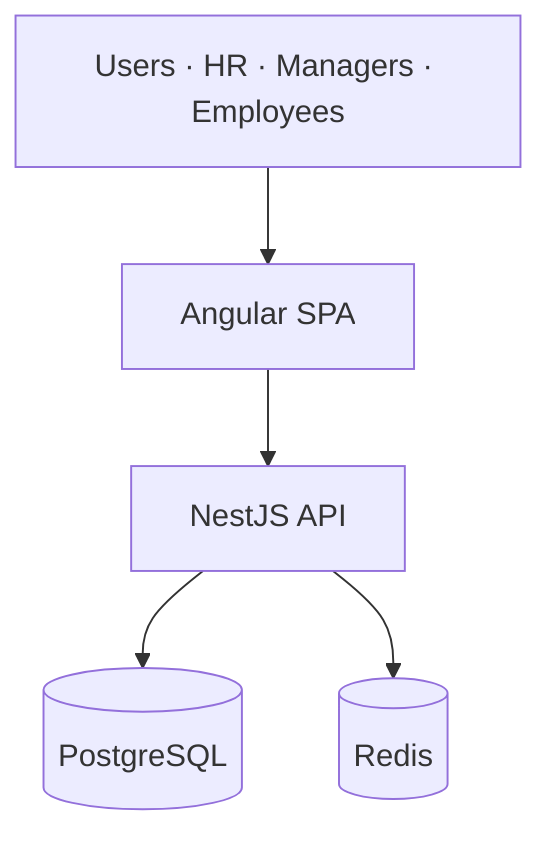

# Soft Data HRMS

**Enterprise Workforce Operations Platform**  
Complete employee lifecycle management for Soft Data LLC — hiring, people ops, leave, timesheets, UAE payroll, documents, and analytics.

<p align="center">
  
</p>

<p align="center">
  <a href="#product-overview">Overview</a> ·
  <a href="#key-capabilities">Capabilities</a> ·
  <a href="#demo-video">Demo video</a> ·
  <a href="#product-screens">Product screens</a> ·
  <a href="#platform">Platform</a> ·
  <a href="#try-the-demo">Try the demo</a>
</p>

---

## Product overview

Soft Data HRMS gives HR, managers, and employees one system for the full workforce lifecycle in the UAE / GCC context — with role-based access, configurable modules, and payroll built for WPS-oriented operations.

| Domain | What Soft Data delivers |
|---|---|
| People | Employee directory, org structure, profiles, lifecycle status |
| Hiring | Job openings, ATS pipeline, interviews, offers |
| Absence | Leave requests & approvals, encashment, org leave policies |
| Time | Timesheets and optional attendance |
| Payroll | Monthly runs, proration, payslip PDF, branding, WPS & EOS |
| Documents | Request → review → issue workflows |
| Insights | Dashboard KPIs, UAE reports, workforce analytics |
| Control | Super Admin modules, SSO, company branding |

---

## Key capabilities

- End-to-end HR workspace for Soft Data LLC  
- UAE-ready payroll (components, formulas, WPS SIF, end-of-service)  
- Role-aware experience (Super Admin, HR, Manager, Payroll, Recruiter, Employee)  
- Super Admin controls: modules, SSO, branding, **organization leave entitlements**  
- Payslips with company logo / stamp and manager signatures  
- One-command Docker demo for live walkthroughs  

---

## Demo video

Full product walkthrough:

**[`docs/demo/soft-data-hrms-full-demo.mp4`](docs/demo/soft-data-hrms-full-demo.mp4)**

---

## Product screens

### Login


### Workforce dashboard


### Employee directory


### Leave management


### Payroll engine


### Recruitment / ATS


### Document center


### Reports & analytics


Additional captures (organization, timesheets, flight benefits, compliance, settings, and more) are in [`docs/screenshots/`](docs/screenshots/).  
Sample payslip: [`docs/samples/payslip-noah-bennett-oct-2026.pdf`](docs/samples/payslip-noah-bennett-oct-2026.pdf).

---

## Platform



| Layer | Stack |
|---|---|
| Experience | Angular 20 · modern Soft Data UI |
| API | NestJS · JWT security · role guards |
| Data | PostgreSQL · Prisma · Redis |
| Delivery | Docker Compose · nginx |

---

## Try the demo

```bash
cp .env.example .env
npm run docker:up
```

- **App:** http://localhost:8080  
- **API health:** http://localhost:3000/api/health  

### Demo access

Password for all users: **`Password123!`**

| Email | Role |
|---|---|
| `alex.parker@softdata.demo` | Super Admin |
| `maya.reed@softdata.demo` | HR Manager |
| `ethan.cole@softdata.demo` | Manager |
| `noah.bennett@softdata.demo` | Employee |
| `olivia.hart@softdata.demo` | Payroll |
| `liam.foster@softdata.demo` | Recruiter |

Suggested path for investors: login as **Alex** → Dashboard → Employees → Leave → Payroll → Recruitment → Reports.  
Org leave days: **Settings → Modules → Leave policies**.
