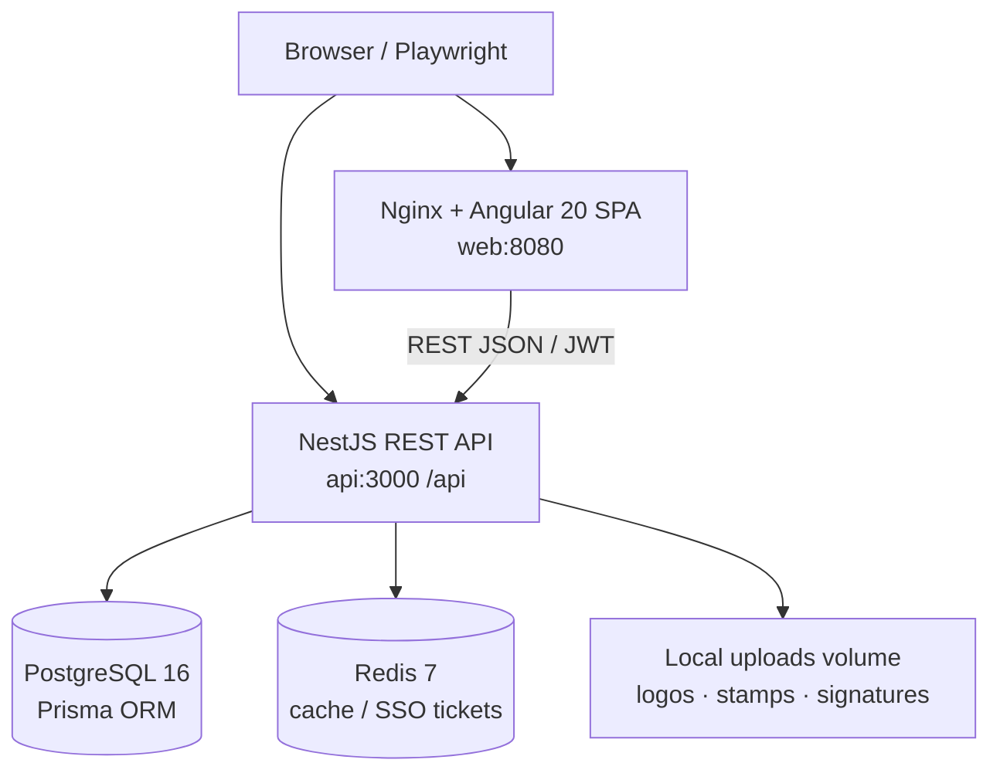

# Soft Data HRMS — System Architecture

**Validated:** 2026-10-08 against local Docker Compose (`web` :8080, `api` :3000, `db` :5432, `redis` :6379).

## 1. High-level topology



## 2. Frontend (Angular 20)

| Concern | Implementation |
|---|---|
| Framework | Angular 20.3 standalone components, lazy feature routes |
| Location | `frontend/` (Angular CLI project) |
| Styling | Bootstrap 5.3 + SCSS design tokens (`frontend/src/styles.scss`) |
| State | Signals + injectable feature services; mock DB for ATS/demo UI domains |
| Auth | JWT in storage; `authGuard`, `roleGuard`, `attendanceGuard` |
| HTTP | `api.interceptor` → `environment.apiUrl` (`/api` in Docker via nginx) |
| Features | Dashboard, Employees, Org, Leave, Timesheets, Payroll (UAE), Recruitment, Documents, Management Requests, Reports, Administration, Settings (Modules / branding / SSO) |

**Routing model:** Authenticated shell (`MainLayoutComponent`) loads feature modules lazily. Role metadata on routes enforces UI access; Nest `RolesGuard` enforces API access.

## 3. Backend (NestJS)

| Concern | Implementation |
|---|---|
| Runtime | NestJS 10 on Node 20 (dev Dockerfile with volume-mounted `src`) |
| Prefix | Global `/api` |
| Security | `helmet`, CORS allow-list, `ValidationPipe` (whitelist + forbid unknown), JWT + Roles + Throttler (120/min) |
| Data | Prisma → PostgreSQL; PII fields encrypted via `PiiCryptoService` (AES) |
| Cache | Redis optional (`REDIS_ENABLED`) for SSO tickets / cache |
| Organization | Single Soft Data org (`Tenant` + modules + branding); internal `tenantId` scoping |

### Module map (controllers)

Auth · Tenants · Employees · Payroll · Payroll-Config · WPS · EOS · Leave-UAE · Holidays · Currency · Reports · Compliance · Projects · Timesheets · Management-Requests · Flight-Benefits · Notifications · Signatures · Health

## 4. Authentication & authorization

1. `POST /api/auth/login` with `{ email, password }` → Soft Data org → bcrypt verify → JWT (`sub`, `tenantId`, `email`, `role`, `employeeId`).
2. Optional SSO (Azure / Google OIDC) when Super Admin enables modules.
3. Global `JwtAuthGuard` (except `@Public()`); `RolesGuard` reads `@Roles(...)`.
4. Frontend maps Nest `UserRole` enums to display labels (`Super Admin`, `HR Manager`, …).

## 5. File storage

| Asset | Path / API |
|---|---|
| Tenant logo / stamp | `backend/uploads/tenants/...` · public GET `/api/tenants/public/logo/:id` |
| Manager signatures | Signatures module upload + admin approval |
| Payslip PDF | Generated on demand (`PDFKit`) |

## 6. Environments

| Variable | Role |
|---|---|
| `DATABASE_URL` | Prisma connection |
| `JWT_SECRET` / `JWT_EXPIRES_IN` | Token signing |
| `AES_ENCRYPTION_KEY` | PII crypto (64 hex) |
| `REDIS_*` | Cache / SSO |
| `CORS_ORIGIN` / `FRONTEND_URL` / `API_PUBLIC_URL` | Cross-origin + deep links |
| `FORCE_SEED` | Re-seed Soft Data demo tenant |

## 7. Logging & ops

- Nest console logs (API container)
- Postgres / Redis Docker healthchecks
- `GET /api/health` reports `database` + `redis` status
- `AuditLog` table for security-sensitive actions (login, module updates, branding)

## 8. Hybrid UI data note

Several Angular features (Recruitment ATS board, some Documents/Leave UI demos) still use `MockDatabaseService` / Soft Data demo fixtures for rich UX, while payroll, employees, timesheets, and compliance call the live Nest API. Investor demos should use Docker stack for API-backed domains and the seeded Soft Data personas.

## 9. Repository layout

```text
frontend/   Angular SPA + nginx Dockerfile
backend/    NestJS + Prisma
db/         Postgres init SQL, backup/restore scripts
e2e/        Playwright
docs/       Product docs + demo video/screenshots + samples
```

Compose services: `db`, `redis`, `api`, `web` (internal DNS: `api:3000`, `db`, `redis`). Host ports are for the browser and local tooling only.
